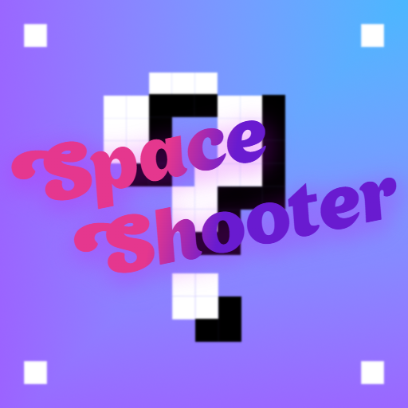
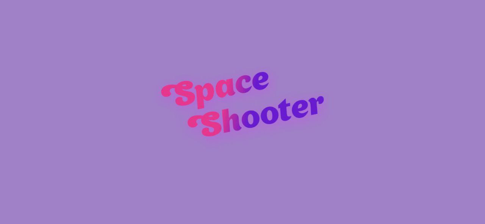
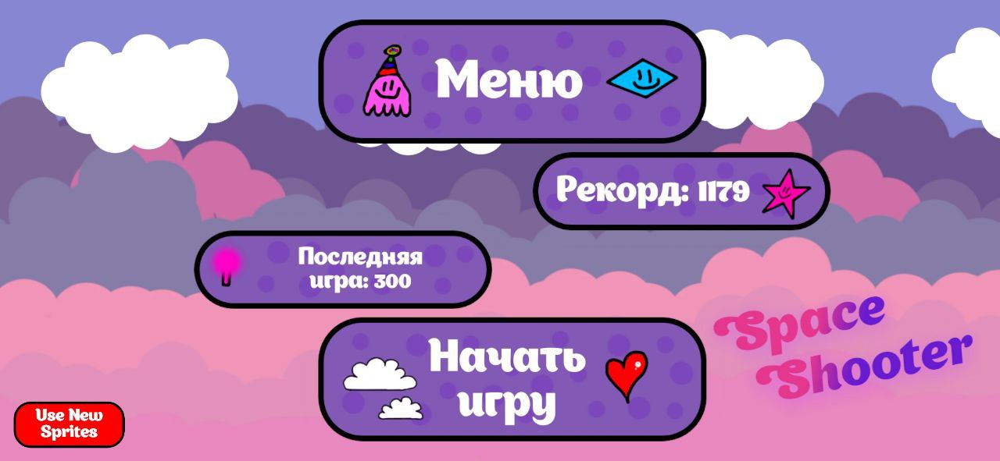
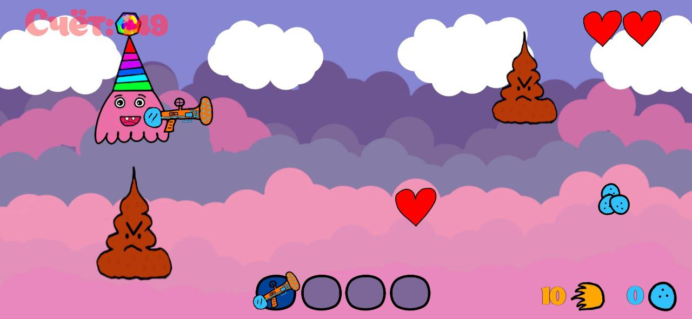
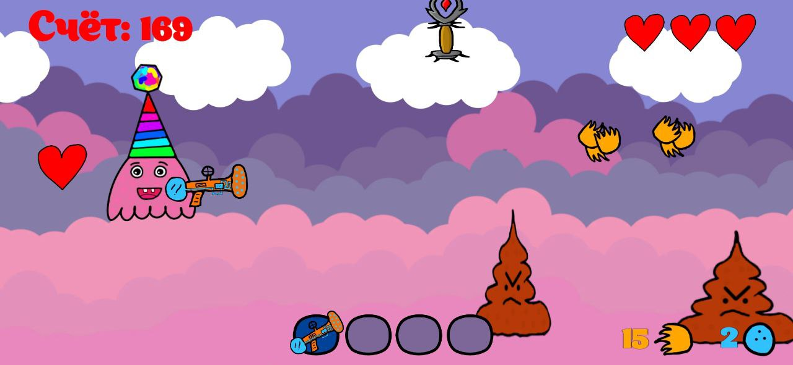
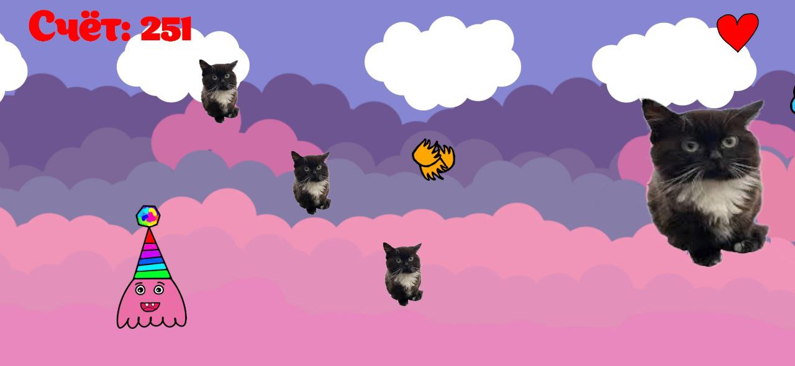
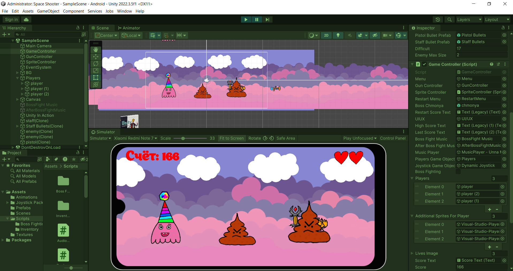

      

   
   
   

## About

An endless game where you have to score as many points as possible. You need to dodge, kill enemies with two different weapons, or pit them against each other to kill them. You also need to defeat the boss by collecting items from the Lucky Block, which can drop various buffs and debuffs. For the developer’s debut game, it’s an interesting title with quite a few mechanics; for the average player, though, it might get boring after 5 minutes of play.

## Distribute

- [Telegram](https://t.me/ghgkgkrjkfjfjkxeddkkw)

## Screenshots

      
      
      
      
      
      

